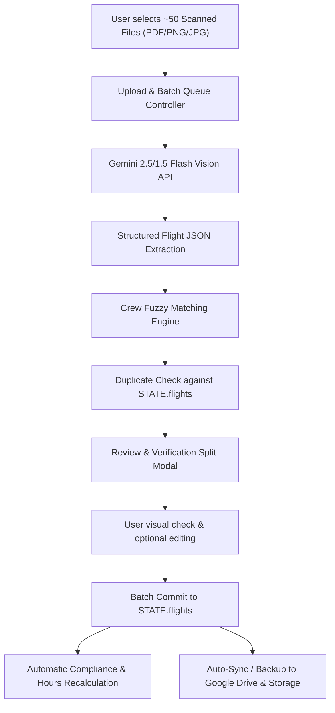

# Design Specification: AI OCR Import of Scanned Training Flight Logs

**Date:** 2026-10-19  
**Status:** Approved by User  
**Target Module:** AeroCheck Training Flights Management  

---

## 1. Executive Summary

This feature adds automated, AI-assisted digitizing of scanned paper and iPad flight log sheets (*"Log sheet of duty time and flight time during training flights"*). Users can batch-upload ~50 scanned PDFs or images. Google Gemini Vision API parses all fields into structured flight records, automatically maps recognized crew names to database profiles, displays an interactive split-view review modal for visual verification, and imports verified records into `STATE.flights` with full compliance updates and Google Drive sync.

---

## 2. Architecture & Data Flow

---

## 3. Detailed Component Breakdown

### 3.1. Settings & API Key Storage
- **Location:** In the "Синхронізація та копії" tab in `index.html`.
- **Field:** `#settings-gemini-api-key` (input type `password` / `text` toggle).
- **Storage:** Persisted in `STATE.settings.geminiApiKey` and `localStorage['aerocheck_settings']`.
- **Validation:** Visual indicator showing key configured status with a test ping button.

### 3.2. Scanned Sheet Recognition Engine (`execution/scan_ocr_parser.js`)
- **Model:** `gemini-2.5-flash` (or `gemini-1.5-flash`) via Google AI Studio REST endpoint:
  `https://generativelanguage.googleapis.com/v1beta/models/gemini-2.5-flash:generateContent?key=${apiKey}`
- **Input:** Base64 image payload (PDFs are converted to canvas/image via standard browser PDF.js or passed directly if supported, or multi-page support).
- **Schema Enforcement:** Gemini structured JSON schema returning:
  - `date`: string (YYYY-MM-DD)
  - `helicopterReg`: string (e.g., "UR-UHB")
  - `fuelStart`: string/number
  - `fuelEnd`: string/number
  - `refuel`: string/number
  - `dutyTime`: string (HH:MM)
  - `totalFlightTime`: string (HH:MM)
  - `totalBlockTime`: string (HH:MM)
  - `preBgn`: string (HH:MM), `preEnd`: string (HH:MM), `preTtl`: string (HH:MM)
  - `postBgn`: string (HH:MM), `postEnd`: string (HH:MM), `postTtl`: string (HH:MM)
  - `crew`: array of:
    - `pstn`: string (PI, PIC, FE instr, AR FA instr, etc.)
    - `name`: string (e.g., "S. Berehovyy", "O. Sokurenko")
    - `flightTime`: `{ day: "00:00", nght: "00:00", nvg: "02:30" }`
    - `blockTime`: `{ day: "00:00", nght: "02:49" }`
    - `timeInstructor`: `{ day: "00:00", night: "02:49" }`
    - `flightTask`: string (e.g., "SPO 356/26/1")
    - `trainingTypes`: array of strings (e.g., ["TRI", "NVG"])
    - `isInstructor`: boolean (derived from pstn / timeInstructor)

### 3.3. Intelligent Crew Matching Engine
- **Input:** Scanned name string (e.g., `S. Berehovyy`, `O. Sokurenko`, `A. Dubinin`).
- **Database Pool:** Combined `STATE.flightCrew` and `STATE.cabinCrew`.
- **Matching Rules:**
  1. Extract surname and initial (e.g. Surname: `Berehovyy`, Initial: `S`).
  2. Bidi-transliteration match (Cyrillic $\leftrightarrow$ Latin, matching both `Full_Name_EN` and `Full_Name_UA`).
  3. Strict match: exact surname + matching initial $\rightarrow$ **High Confidence (100% Green)**.
  4. Levenshtein distance match (tolerance $\le 2$ typos, e.g. `Beregovoy` vs `Berehovyy`) $\rightarrow$ **Medium Confidence (Yellow)** with dropdown candidates.
  5. Unmatched $\rightarrow$ **Grey / New** with a button to pick from existing crew or create.
- **Output:** `{ crewId: string, name: string, crewType: 'Flight'|'Cabin', confidence: 'exact'|'fuzzy'|'none', candidates: [] }`.

### 3.4. Duplicate Detection Engine
- Compares parsed `date`, `helicopterReg`, and `totalFlightTime` against existing entries in `STATE.flights`.
- If match found, flags record: `⚠️ Вже існує в базі (ID: fl_...)` with an option to skip or overwrite.

### 3.5. Review & Verification Split-Modal UI
- **Modal Window:** Accessible via a primary button `📥 Імпорт сканів журналів (ШІ)` in the Training Flights action bar.
- **Left Panel (Batch Queue):**
  - List of all uploaded files (~50 files).
  - Status badges: 🟢 Ready, 🟡 Needs Attention (e.g., unassigned crew or low confidence), ⚠️ Duplicate.
  - Quick statistics bar: `Всього: 50 | Готові: 47 | Потребують уваги: 3`.
- **Right Panel (Inspection & Split View):**
  - Left sub-pane: Interactive scan preview with zoom/pan to inspect handwritten handwriting.
  - Right sub-pane: Editable form fields matching the flight log form.
  - Inline dropdowns for crew matching (displays avatar/badge, position, and matching score).
- **Actions:**
  - `[Зберегти поточний політ]`
  - `[Зберегти ВСІ готові польоти (47)]`
  - `[Видалити зі списку]`

### 3.6. Commit & Data Persistence
- On confirmation, records are appended to `STATE.flights` with generated IDs (`fl_import_...`).
- Automatically triggers compliance profile updates for crew members (including `TRI`, `NVG`, `NAIROBI`, `LPC`, `OPC`).
- Saves state to `localStorage`.
- Triggers background Drive duplication if Google Drive sync is configured.

---

## 4. Error Handling & Edge Cases
1. **Network / Rate Limiting (Gemini Free tier):** Free tier allows 15 requests per minute (RPM). The batch processor throttles requests with a 4-second delay between pages or process in batches of 10 to prevent HTTP 429 errors.
2. **Ditto marks (`-"-` or `//`):** The Gemini system prompt explicitly handles repetition symbols in "№ Flight Task" or "Flight Time", repeating values from the preceding crew row.
3. **Multi-page logs:** If a flight log has page 1 and page 2 (backside), user can upload pairs or the system groups them by date/reg.
4. **Empty rows / crossed-out rows (Z-strike):** Gemini Vision prompt instructs to ignore struck-out rows.

---

## 5. Testing Plan
- Test with the user's provided sample PDF (`UR-UHB`, `16.10.2026`, `S. Berehovyy`, `TRI`, `NVG`).
- Verify exact extraction of fuel, duty time, block time, briefings, and instructor hours.
- Verify crew matching against `STATE.flightCrew`.
- Verify persistence to `STATE.flights` and correct propagation to crew qualification tables.
